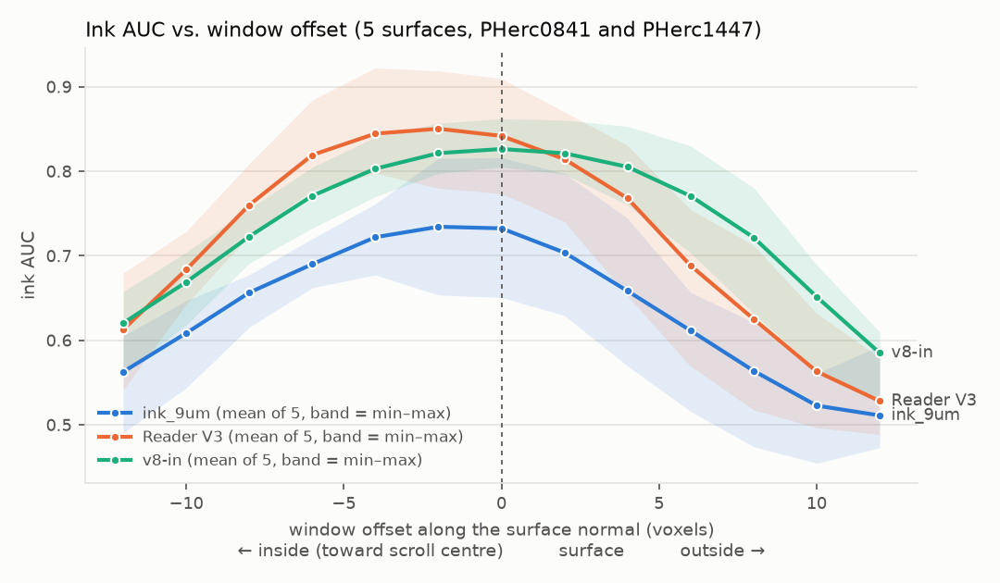

# offset_sweep: measure how much surface offset costs your ink model – with curves for three models and three pre-registered negative results

I'm new to the Vesuvius Challenge. When I started in October, the tutorial took me much longer than expected, and whenever an ink map came out blank I didn't know whether there was no ink or whether my surface was simply in the wrong place. offset_sweep answers the second question with numbers: how much ink signal you lose when the surface is a few voxels off, for your own model and labels. I hope it saves newcomers some of the hours it cost me.

**TL;DR**
- **Cost of an offset:** shifting a model's input window 4 voxels along the surface normal costs up to 0.07 ink AUC, 8 voxels 0.08–0.22 (mean over five labelled surfaces, three models; the AUC at the traced surface is 0.73–0.84).
- **Which side hurts depends on the model:** for ink_9um and Reader V3, which read 17 layers, moving the window outward costs far more than moving it inward (8 voxels: −0.17/−0.22 outward vs −0.08 inward), and on these surfaces their best window sat about 2 voxels inside the traced mesh (the best offset lay inside the mesh on 5/5 surfaces for Reader V3 and 3/5 for ink_9um). v8-in, which reads 24 layers, loses about equally on both sides and peaks at the mesh (best offset inside on 1/5, outside on 1/5). A small sample: 5 surfaces from 2 scrolls.
- **Two fixes failed their pre-registered criteria:** neither snapping the window to the brightest sheet layer (Test B) nor averaging predictions over shifted windows (offset ensemble) recovers enough of the loss. The ensemble of five windows (5× compute) recovered on average 7–64 % of the loss where at least 50 % at both ±4 and ±8 voxels was required, so 0 of 3 models passed; the snap lowered the AUC even at offset 0 (−0.012 to −0.092).

`offset-sweep` computes this curve for **your** model on **your** labelled surface in one command. It calls villa's
own ink inference (`--layer-start/--layer-end`) and has no model logic of its own.

## Install

Linux with an NVIDIA GPU and Python 3.14 (villa's `vesuvius` package requires 3.14). With [uv](https://docs.astral.sh/uv/):

```bash
uv venv -p 3.14 .venv && . .venv/bin/activate
uv pip install torch "vesuvius @ git+https://github.com/ScrollPrize/villa@e2254ebe0168a232e5ba7b94997c749b4e6a4544#subdirectory=vesuvius" \
    "offset-sweep @ git+https://github.com/LynnHenry/offset-sweep" einops==0.8.2 timm==1.0.27 imagecodecs==2026.6.26
```

`einops` and `timm` are needed to build villa's ink models, `imagecodecs` to write villa's LZW-compressed
probability TIFFs. villa lists them only in its large `models` extra (126 more packages), so they are named here,
pinned within villa's bounds (`einops>=0.8.1`, `timm>=1.0.20`, `imagecodecs>=2026.3.6`). If one is missing,
`offset-sweep` stops before the first inference and prints this install command.

For v8-in through `--command`, its own code needs two more packages (from its `requirements.txt`; versions as tested):

```bash
uv pip install opencv-python-headless==5.0.0.93 huggingface-hub==1.22.0
```

This pulls torch with CUDA 13.2 wheels from PyPI (~3 GB of packages) and villa at a pinned commit that has
`--layer-start/--layer-end`. If your driver needs another CUDA build, install torch first from the matching index,
e.g. `uv pip install torch --index-url https://download.pytorch.org/whl/cu126`, then run the line above.

**Tested on:** Windows with WSL2 (Linux kernel 6.18), NVIDIA RTX 3080 10 GB, driver 621.01 (CUDA 13.5 user-mode driver),
Python 3.14.4, torch 2.15.0+cu132 from PyPI. Nothing here is WSL-specific; the same install should work on native Linux.
Other CUDA versions are untested. If `torch.cuda.is_available()` is `False` after the install, your driver is probably older
than the torch build: install torch from the index that matches `nvidia-smi` (as above), not a newer one.

## Two ways in

**A. You already have a surface volume (no VC3D needed).** A folder of layer TIFFs (`00.tif`, `01.tif`, …) or a Zarr
`(layers, H, W)`:

```bash
offset-sweep run --surface-volume my_segment_layers/ --labels inklabels.png --label-mask mask.png \
    --checkpoint step-050000.pth --direction reverse --outward higher --out sweep/
```

The range follows from the data. A model that reads *W* layers fits into a *D*-layer stack with at most
±(D − W)/2 voxels of shift, so `offset-sweep` runs the requested offsets that fit and says so, e.g.
*with these data only ±5 voxels are possible (28 layers, model window 17); … For a larger range render more layers
yourself.* For villa checkpoints *W* is read from the checkpoint (ink_9um and Reader V3: 17 layers).

| published surface volume | layers | range with ink_9um / Reader V3 (17) |
|---|---|---|
| PHerc0841 official segments (9.366 µm) | 28 | ±5 voxels (±4 with the default step 2) |
| PHerc1447 w058/w060 on Hugging Face | 24 | ±3 voxels (±2) |
| our renders for the curves below | 64 | ±23 |

For ±12, as in the curves below, you need 42 layers for these models: render them yourself (B, or any renderer such
as [inksweep](https://github.com/inksweep/inksweep)'s `render`, which also works without VC3D).

**B. You have a tifxyz mesh.** `offset-sweep` renders the layers it needs with `vc_render_tifxyz` from the
[VC3D AppImage](https://github.com/ScrollPrize/villa/releases), streaming only the chunks it reads.

## Quickstart: public example (PHerc1447 w058)

**Way A, no VC3D.** A 42-layer render of the labelled region of PHerc1447 w058 is published as a separate dataset,
[LynnHenry/offset-sweep-example](https://huggingface.co/datasets/LynnHenry/offset-sweep-example) (147 MB, CC BY-NC 4.0, non-commercial; see its card).
The ink labels stay in YoussefMoNader's dataset.

```bash
mkdir example && cd example
# 42-layer surface volume (147 MB); needs `pip install huggingface_hub` for the hf command
hf download LynnHenry/offset-sweep-example --repo-type dataset --local-dir w058_example
# refined ink labels (YoussefMoNader, CC BY-NC 4.0), 0.6 MB
H=https://huggingface.co/datasets/YoussefMoNader/ink-8um-pherc1447-surfaces/resolve/7e4d918/w058/labels
curl -fsSL -O $H/inklabels.png && curl -fsSL -O $H/mask.png
# ink_9um checkpoint (0.14 GB)
curl -fL -o step-050000.pth https://huggingface.co/scrollprize/ink_9um/resolve/main/hybrid_3d2d-seed43/step-050000.pth

offset-sweep run --surface-volume w058_example/layers --crop 671,2868,3762,1500 \
    --labels inklabels.png --label-mask mask.png \
    --checkpoint step-050000.pth --direction reverse --outward higher --out sweep_w058
```

`--crop` tells `offset-sweep` where the 3762 × 1500 px volume sits in the full w058 surface grid, so it can cut the
full-size labels to match.

On an RTX 3080 10 GB the whole block took 3 min 19 s in our test, downloads included: 13 offsets at 12–16 s each plus
the layer-order check, at most 1.9 GB RAM and about 0.6 GB of GPU memory.

**Way B, the same region rendered yourself** (VC3D AppImage, 0.13 GB, plus about 1.3 GB of CT chunks streamed
from the open-data server):

```bash
# current "latest" VC3D build (the tag is rebuilt often and old builds disappear from it); prints the build name
U=$(curl -fsSL https://api.github.com/repos/ScrollPrize/villa/releases/tags/latest \
    | grep -o '"browser_download_url": *"[^"]*linux-x86_64\.AppImage"' | grep -o 'https://[^"]*')
echo "VC3D build: ${U##*/}"
curl -fL -o VC3D.AppImage "$U" && chmod +x VC3D.AppImage
[ "$(head -c 4 VC3D.AppImage | tail -c 3)" = ELF ] && [ "$(stat -c %s VC3D.AppImage)" -gt 50000000 ] \
    || { echo "ERROR: VC3D.AppImage is not an AppImage; download it from https://github.com/ScrollPrize/villa/releases"; false; }
H=https://huggingface.co/datasets/YoussefMoNader/ink-8um-pherc1447-surfaces/resolve/7e4d918/w058
for f in tifxyz/x.tif tifxyz/y.tif tifxyz/z.tif tifxyz/meta.json labels/inklabels.png labels/mask.png; do
  mkdir -p w058/$(dirname $f) && curl -fsSL -o w058/$f $H/$f; done

offset-sweep run --tifxyz w058/tifxyz \
    --volume https://vesuvius-challenge-open-data.s3.us-east-1.amazonaws.com/PHerc1447/volumes/20250521151220-8.640um-1.2m-116keV-masked.zarr \
    --vc3d ./VC3D.AppImage --crop 671,2868,3762,1500 \
    --labels w058/labels/inklabels.png --label-mask w058/labels/mask.png \
    --checkpoint step-050000.pth --direction reverse --outward higher --out sweep_w058_b
```

Tested with VC3D build `37d1897` (2026-10-29); the example dataset of way A was rendered with build `7154682`
(2026-10-28). The `latest` tag is rebuilt often, so you will probably get a newer build, which can render slightly
differently: compare your curve with way A's as a sanity check, not for equality. In our test the two ways gave
identical curves despite the different builds (all 13 offsets; AUC at offset 0 = 0.742).

**Code and data are licensed separately.** This repository (code) is MIT. The example dataset, the scans and
everything rendered from them are CC BY-NC 4.0 (non-commercial) and are not part of this repository.

VC3D keeps the streamed CT chunks under `~/.VC3D/` (each chunk is stored twice, so the cache grows by about twice the
download). `VC3D_CONFIG_DIR` does not move this cache; to keep it elsewhere, run with another `HOME`, e.g.
`HOME=/data/vc3d offset-sweep run …`.
`--direction reverse` and `--outward higher` are right for `vc_render_tifxyz` renders whose mesh normals point away
from the scroll axis, as here; for your own meshes see *Options that matter* and *Plausibility warnings*.

## What it does

1. **Render** (way B only): `vc_render_tifxyz` renders `window + 2 × max|offset|` layers along the mesh normal at
   native resolution, rounded up to an even count so that layers sit at ±0.5, ±1.5, … voxels from the mesh as in our
   renders (`--crop X,Y,W,H` renders only a region; the labels are cut the same way).
2. **Shift**: for each offset *o* the model sees layers `[D//2 − W//2 + o, D//2 − W//2 + o + W)` of the `D`-layer
   stack, where *W* is the number of layers the model reads. Offset 0 is exactly the centre crop villa's inference
   takes from the full stack (tested, see below).
3. **Infer**: `python -m vesuvius.ink_detection.inference.infer <volume> <checkpoint> <out.tif> --layer-start … --layer-end …`
   once per offset, default `--overlap 0.5 --blend-mode hann --batch-size 4` (change with `--infer-args`). Layer TIFFs
   are staged once as a temporary Zarr, which villa's inference reads.
4. **Score**: pixel ROC AUC of the raw probability map against your ink labels, on `label mask ∩ pixels valid at every
   offset`, so every offset is scored on the same pixels.
5. **Check**: one extra run at offset 0 with the opposite layer order (skip with `--no-order-check`).

### Plausibility warnings

`offset-sweep` still writes the curve, but warns on stderr and in `run.json` when
- the AUC at offset 0 is below 0.6 (close to chance), or
- the opposite layer order scores more than 0.05 higher at offset 0.

Both usually mean a wrong `--direction` / `--reverse-layers`, labels on another grid or scale, or a mesh that is far
off the sheet. ink_9um, for example, is close to blind in the wrong layer order (see *Related work*).

### Options that matter

| option | meaning |
|---|---|
| `--outward higher\|lower\|unknown` | **required.** Which way the layer index points away from the scroll centre. In `vc_render_tifxyz` renders the index grows along the mesh normal; if your normals point outward, use `higher`. With `unknown` the plot is labelled by layer index only. |
| `--direction forward\|reverse` | villa models: the layer order the model was trained on. ink_9um, Reader V3 and v8-in all need `reverse` on `vc_render_tifxyz` renders with outward normals (index grows outward). |
| `--command '… {input} … {output}'` | any model outside villa. Each window is written as a Zarr (`{input}`, array `0`, layers × H × W) and the command must write a probability TIFF on the same grid to `{output}`. |
| `--reverse-layers` | with `--command`: flip each window before the model sees it (models trained on the opposite layer order, such as v8-in on our renders). |
| `--offsets -12:12:2`, `--window W` | offsets in voxels (start:stop:step or a list; must include 0). `--window` is the number of layers the model reads; villa checkpoints carry it, `--command` models need it (v8-in: 24). |

Errors are reported in one line, e.g. *no offset is possible: 17 layers and a 17-layer window leave ±0 voxels …*,
*ink labels are 8184 x 4512 px but the surface volume is 4092 x 2256 px. The ratio is 2.000 in both axes …*,
*the evaluated area has no ink pixels*.

### Runtime and memory

Measured in test (b) on the public example (PHerc1447 w058, 3762 × 1500 px, 42 layers, ink_9um, offsets −12 … +12 in
steps of 2 plus the layer-order check), RTX 3080 10 GB, WSL2:

| step | time | memory |
|---|---|---|
| install (from a warm uv cache; the first install downloads about 3 GB of packages) | 0.5 s | – |
| way A, whole quickstart block incl. the checkpoint download | 3 min 19 s | 1.9 GB RAM, ~0.6 GB GPU |
| one offset (villa inference of ink_9um) | 12–16 s | |
| way B, render with VC3D (about 1.3 GB of CT chunks streamed; VC3D's cache grows by 2.6 GB) | 69 s | |
| way B, whole block incl. VC3D and mesh download | 4 min 29 s | 2.0 GB RAM |

RAM is the peak of the largest single process; GPU memory is the peak above the idle desktop. Larger models cost
more: in our curves one window took 22–43 s for ink_9um or Reader V3 on a whole surface and 7.5–17 min for v8-in on
the labelled crop.

## Main result: the offset curve of three models



Mean ink AUC over the five surfaces at offset 0 and its change at each offset (negative offset = inside, toward the
scroll centre; positive = outside). Per-surface values and ±10/±12 are in the CSV.

| model (window) | AUC at 0 [min–max] | −8 | −4 | −2 | +2 | +4 | +8 |
|---|---|---|---|---|---|---|---|
| ink_9um (17) | 0.732 [0.65–0.82] | −0.076 | −0.010 | +0.002 | −0.029 | −0.074 | −0.169 |
| Reader V3 (17) | 0.842 [0.77–0.91] | −0.082 | +0.003 | +0.008 | −0.027 | −0.074 | −0.217 |
| v8-in (24) | 0.826 [0.81–0.86] | −0.104 | −0.023 | −0.005 | −0.005 | −0.021 | −0.105 |

Best offset per surface (PHerc0841 w00, ag144, ag174, PHerc1447 w058, w060): ink_9um 0, −2, −2, 0, −4; Reader V3 −4, −2,
−2, −2, −4; v8-in 0, 0, +2, 0, −2.

**Rule of thumb for mesh builders** (descriptive, from the curves above): for these five surfaces,
- within ±2 voxels of the traced surface every model keeps its mean AUC to within 0.03;
- 4 voxels off costs up to 0.07 and 8 voxels 0.08–0.22, so a mesh that is 8 voxels off loses a large part of what the model can read;
- if a mesh is uncertain and you use ink_9um or Reader V3, place the window toward the scroll centre rather than outward: 4 voxels inside cost them ≤ 0.01, 4 voxels outside 0.07, and their best offset per surface lay inside the mesh on 5/5 surfaces (Reader V3) and 3/5 (ink_9um). For v8-in both directions cost about the same (best offset inside on 1/5 surfaces, outside on 1/5). With 5 surfaces from 2 scrolls this is a small sample.

Offsets are measured relative to the traced meshes, so the asymmetry has two possible explanations that these data do
not separate: (1) the five meshes sit systematically a little outside the inked layer, so moving inward moves the window
toward the ink; (2) the 17-layer models read the ink a little inside their window centre, or what lies outside the
surface misleads them more than what lies inside. v8-in peaks at the mesh on the same surfaces, which speaks against
(1) as the whole story, but its window is wider, so this is not a test. Either way, “2 voxels inside” is a finding about
these surfaces and models, not a general correction for meshes.

Data: [`results/curves.csv`](results/curves.csv), one row per model, surface and offset (AUC, ΔAUC, ensemble AUC).

## Three pre-registered negative results

All criteria were written down with a date before the measurement and not changed afterwards; deviations are listed
in full under *Method*.

### 1. Sheet snap (Test B): NO-GO
Idea: estimate per 64-px tile where the brightest sheet layer lies (mean depth profile over 64 layers, σ = 1) and move
the 28-layer window there, without labels. Criteria: (a) at offset 0 no model and segment may lose more than 0.02 AUC;
(b) at |offset| = 4 and 8 the snap must recover at least half of the loss on average.
Result (ink_9um, Reader V3; 5 surfaces):
- (a) failed. Snapping lowered the AUC in all 10 cases (−0.012 to −0.092), 8 of 10 by more than 0.02.
- (b) failed. The mean recovered share was −0.10 at |s| = 4 and +0.13 at |s| = 8.
- Why: the snap target followed a known shift with a slope of only about −0.3 layers per voxel instead of −1. The
  tile depth profile does not locate the inked layer well enough, and its noise moves a well-placed window off target.

### 2. Sheet-contrast preflight check: parked, not submitted as a PR
Idea: a warn-only gate in villa's `surface_preflight` that samples up to 64 tiles and checks for a bright sheet band in
the 28-voxel profile along the normal (after rodriguescarson's eligible-scroll-atlas `profile.py`). Pre-registered
validation:

| check | criterion | result |
|---|---|---|
| V1: our 6 curated controls | all within tolerance of our render values and above their protocol threshold | 4/6, missed |
| V3: 20 random official PHerc0139 segments | ≥ 18/20 pass | 20/20 |
| V4: the same 20 segments shifted 20 voxels along the normal | ≥ 18/20 warn | 13/20, missed |

V4 is the important miss. After a 20-voxel shift the contrast barely drops (it stays at 0.55–0.76, threshold 0.44),
because the neighbouring wrap moves into the window. Only the peak position separates the cases. The measure tells you
whether there is papyrus near the surface. It does not tell you whether the surface is on the right sheet.

### 3. Offset ensemble: NO-GO (0 of 3 models)
The ink_9um model card suggests averaging predictions over a few nearby z windows as a simple ensemble. We tested it
on the same runs: E(o) = mean of the raw maps at o − 4, o − 2, o, o + 2, o + 4. Criteria, per model:
- (a) at offset 0 the ensemble may lose at most 0.02 AUC (mean over surfaces);
- (b) where a single window loses ≥ 0.02, the ensemble must recover at least half of the loss on average, separately at |o| = 4 and |o| = 8.

GO if both hold for at least 2 of 3 models.

| model | (a) ΔAUC at 0 (≥ −0.02) | (b) mean recovered share at \|o\| = 4 | at \|o\| = 8 | (a) and (b) |
|---|---|---|---|---|
| ink_9um | +0.016 ✓ | 0.64 (n = 6) ✓ | 0.38 (n = 9) ✗ | no |
| Reader V3 | +0.008 ✓ | 0.46 (n = 6) ✗ | 0.48 (n = 10) ✗ | no |
| v8-in | −0.002 ✓ | 0.07 (n = 5) ✗ | 0.15 (n = 10) ✗ | no |

n = surface × sign pairs where the single window lost at least 0.02. The maximum instead of the mean over the five
windows (descriptive only) does not change the picture: 0.59/0.45, 0.44/0.57 and −0.02/0.36.

Compute: one window costs 22–43 s for ink_9um or Reader V3 on a whole surface and 7.5–17 min for v8-in on the labelled crop (RTX 3080); the ensemble needs five, i.e. **5×** the inference time for an AUC gain of +0.006 to +0.074 where the single window loses (ink_9um, Reader V3) and of −0.002 to +0.019 for v8-in. It does no harm at offset 0, and for the two 17-layer models it softens the loss, but it does not recover enough to replace a correctly placed surface.

## Related work, and what is new here

Depth sensitivity of ink models is known, and several people have measured or used it. This repository builds on that work.
- **Team guidance.** The ink_9um model card and Tutorial 5 note that the models are sensitive to depth offsets. They suggest shifting `--layer-start/--layer-end`, or averaging a few nearby windows as a simple ensemble. The offset ensemble tested here is that suggestion.
- **Offset sweeps as a tool.**
  - villa PR #1872 (Danishk2445, closed without merge) proposed `inference.sweep`: checkpoints × depth offsets (−2 … +2) × directions, scored by AUC.
  - [inksweep](https://github.com/inksweep/inksweep) runs GPU depth sweeps over d = −15 … +15 for several readers and renders without VC3D. It implements the First Letters recipe of E. Nieuwlaar, which averages per-model z-scores over all 31 depths.
  - `offset-sweep` is smaller. It scores one model against labels at each offset, labels the inside/outside side and warns on a likely wrong layer order. It runs on released villa, on layer TIFFs, or on any model through `--command`.
- **Offset cost measured before.**
  - Hyojun Kwon ([khj1222/vesuvius-challenge](https://github.com/khj1222/vesuvius-challenge), docs/31, pre-registered) measured ink_9um over ±5 pooled 9.6 µm slices on scrolls it never saw. The loss is strongly one-sided (0.14–0.17 F1 at −5, 0.03–0.04 at +5), and wider depth jitter in training did not buy it back.
  - Our curves extend this to three models, ±12 native voxels, two scan protocols and an inside/outside axis from geometry.
- **Depth windows on other data.**
  - TAUIL Abd Elilah (villa #1912, [cross-scan-ink-transfer](https://github.com/TAUIL-Abd-Elilah/cross-scan-ink-transfer)) picks the best of five depth windows (±96 µm) label-free for the 2 µm model; a pixel-wise maximum over depths did not help. In the same thread, neg-0 extended the search to 25 depth steps.
  - Reader v2's “best quality” mode averages three 17-layer windows (centre, ±2) at offset 0 (PHerc0841 0.824 → 0.834). That is consistent with our criterion (a): averaging does not hurt at offset 0.
- **Moving the surface instead of the window.** [recto-offset](https://github.com/TAUIL-Abd-Elilah/recto-offset) learns to push meshes back onto their sheet and found that snapping to the CT edge costs ink (Reader V3 on PHerc0841, −0.049 AUC). That agrees with our sheet-snap NO-GO.
- **Diagnostics that this curve could feed.**
  - The Ink Recoverability Protocol ([dlescanogithub/vesuvius-inkcheck](https://github.com/dlescanogithub/vesuvius-inkcheck)) decides whether a missing reading is due to the scan, the model or the scroll. Its scan check uses dose-responses for blur and noise, not for surface offset; an offset curve like these would be the matching building block for that question.
  - The IRP README also notes that on a tightly rolled scroll the depth-reversed side faces the neighbouring winding. Our asymmetry (moving outward costs more than moving inward) is consistent with that picture of what lies on either side of the surface; it does not prove it.
  - [ink-sensitivity](https://github.com/Shakhtar-Sankur/ink-sensitivity) (injection-recovery) finds ink_9um nearly blind in the reversed depth order (0 of 48 real-text windows recovered on PHerc0139). This is consistent with the large gaps between layer orders we see, and it is why `offset-sweep` runs the opposite order once at offset 0 and warns when it scores higher.

New here:
- The full offset curves, with the inside/outside asymmetry, for ink_9um, Reader V3 and v8-in on PHerc0841 and PHerc1447. None of the three models has seen either scroll.
- Two pre-registered negative results on recovering offset losses without labels: sheet snap and the offset ensemble.
- A small, tested tool to reproduce such a curve for any model.

## Method

- **Surfaces:** PHerc0841 w00, ag144, ag174 (official segments, 9.366 µm / 113 keV volume) and PHerc1447 w058, w060
  (surfaces and refined labels by YoussefMoNader, 8.64 µm / 116 keV volume). 64-layer `vc_render_tifxyz` renders at native
  resolution; their centre 28 layers (18–45) equal our earlier 28-layer renders (r = 1.000).
- **Labels:** 0841: official labels made at 2.403 µm, area-weighted onto the 9.366 µm render grid (≥ 0.5), evaluated on
  the supervision mask. 1447: `inklabels.png` (> 127) on `mask.png`. Labels are used for scoring only.
- **Offset and window:** an offset *o* moves the **centre of the window** the model reads by *o* voxels along the
  mesh normal; the window keeps its width. The width is the model's own input depth, read from its checkpoint or
  model card: **ink_9um and Reader V3 read 17 layers, v8-in reads 24.** In our runs each model received a 28-layer
  window, and villa (ink_9um, Reader V3) or the v8-in wrapper took its centre 17 or 24 layers. That is exactly the
  window `offset-sweep` hands them (tested), so the curves are curves of 17- and 24-layer windows. The renders have
  64 layers at ±0.5 … ±31.5 voxels from the mesh, one voxel apart.
- **Models and layer order:** ink_9um (`hybrid_3d2d-seed43/step-050000`), Reader V3, v8-in. All three are fed in reverse
  order on these renders, where the layer index grows outward. v8-in runs on a crop around the labels (+128 px, origin
  on its 21-px tile grid; identical to the full-segment prediction, r = 1.000).
- **Inside/outside:** all five renders have their low layer index on the scroll-centre side (checked from geometry),
  so positive offsets point outward.
- **Training locks:** none of the three models has seen PHerc0841 or PHerc1447.
  - ink_9um: model card (huggingface.co/scrollprize/ink_9um, README lines 18 and 53) lists its training scrolls; neither PHerc0841 nor PHerc1447 is among them.
  - Reader V3: `train_config.json` (DomRusso2/reader-v3 4a9f1c6, lines 160–710, 13 data sets) and `hf/manifest.csv` (70 segments). Zero hits for 0841, 1447 or the three 0841 segment IDs. `README_labels.md` lines 40–41: “every PHerc0841 segment [is] NOT included: they are the evaluation set”. The only “w058” (manifest line 17) is PHerc0139 w058.
  - v8-in: model card (YoussefMoNader/ink-8um-v8in, README lines 20–22) lists its training scrolls and a fragment; neither PHerc0841 nor PHerc1447 is among them.
- **Deviations from the pre-registration (complete list for these three studies):**
  Each was written down with a time stamp before the measurement it affects; none changed a criterion.
  1. *Sheet snap:* the download fallback stages (both scrolls → PHerc0841 only → cached data only) were not needed;
     both scrolls were used. A first start stopped at once on a broken cache folder and was restarted unchanged; its partial evaluation
     wrongly printed NO-GO without data and now prints “incomplete”.
  2. *Offset ensemble:* v8-in tiles its input on a fixed 21-px grid from the image edge, so a crop whose origin is
     off that grid shifts every tile (r = 0.967 in a dry run). The crop origin was therefore rounded down to a
     multiple of 21. With it the crop prediction equals the full-segment prediction (pre-check r ≥ 0.99, measured
     r = 1.000 on all five surfaces).
  3. *Preflight check:* tiles are sampled on a fixed 16 × 16 grid with bilinear interpolation instead of only at the
     mesh grid points, because official PHerc0139 meshes (scale 0.05) have only 3 × 3 grid points per tile. Fixed
     10 minutes before the first validation measurement.
  4. *Tool tests c and d:* to compare the same pixels as the original runs, test d scores `offset-sweep` on the runs'
     evaluation mask (label mask ∩ valid at all 13 offsets). On both test surfaces this mask is pixel-identical to the
     tool's default mask, so the choice does not change the result.

## Tests of the tool

Unit tests: `pytest tests` (18 tests, no GPU; a stand-in model replaces villa). Checks on real data, RTX 3080, criteria
fixed before each measurement:

| test | criterion | result |
|---|---|---|
| (a) fresh install from this README, new clone and new environment | the commands run and the example works | **first failed twice, fixed.** (1) The original install line lacked `einops` and `timm`, which villa's model code needs (see *Install*); the first run stopped at the model build. After adding them, every model was built on the CPU and run once on a dummy input, which passed. (2) The next run of (b) then stopped after the first inference: villa could not write its LZW-compressed output TIFF without `imagecodecs`; the dummy check had not written any output. Both packages are now in the install line, and `offset-sweep` checks for them before the first inference. The final check takes the install commands verbatim from this README's code blocks, in a new environment, and runs all three models (ink_9um, Reader V3, v8-in) end to end on the CPU, on a 384 × 384 px cut of the example, up to the written prediction TIFFs, `curve.csv` and `curve.png`: **passed** (AUC at offset 0 on the cut: ink_9um 0.84, Reader V3 0.95, v8-in 0.93). The very first install was tested over the network; the later environments were built from the local package cache. |
| (b) public example, step by step | both ways run and give a curve | **first failed, fixed; then passed.** The first runs stopped for the reasons in (a). Way B then stopped once: the README named a fixed VC3D file under the `latest` release tag, which had been rebuilt, so `curl` silently saved a 9-byte "Not Found" page. The AppImage is now located through the GitHub API, downloaded with `curl -f` and checked before use. Final run in a new folder and environment, every command taken verbatim from this README's code blocks: way A and way B both ran through and wrote `curve.csv` (13 offsets) and `curve.png`; AUC at offset 0 was 0.742 on both ways, and the two curves agreed at every offset (way B rendered with VC3D build `37d1897`, the example dataset with `7154682`; this comparison is descriptive, not a criterion). Two lines were replaced in that run because they were not public yet: the repository URL (a local snapshot of the same code) and the `hf download` of the example dataset (a local copy of the same files). After publishing, the `hf download` line was run as written, without login, in a new folder: all 45 files matched `SHA256SUMS`. |
| (c) offset 0 equals plain villa inference | r ≥ 0.9995 | **passed:** bit-identical (r = 1.000, largest difference 0, 14.4 M pixels; ink_9um on PHerc0841 w00) |
| (d) curves equal the original runs | \|ΔAUC\| ≤ 0.001 at every offset | ink_9um and Reader V3 on PHerc0841 w00: **passed** (largest difference 5 × 10⁻⁷). v8-in through `--command` on PHerc0841 ag174: **passed** (largest difference 5 × 10⁻⁷) |
| (e) runtime and memory | measured | see *Runtime and memory* |
| (f) licence | same as villa | MIT, like villa |

## Limits

- Five surfaces from two scrolls, with few labelled pixels per surface; the min–max bands are wide.
- The numbers hold for these three models and these two scan protocols (9.366 µm / 113 keV, 8.64 µm / 116 keV).
  Another model or protocol can have a differently shaped curve; that is what the tool is for.
- Offsets are measured by shifting the input window, not by moving the mesh. A real mesh error also bends and tilts the
  surface locally.
- 0841 labels were made on 2.403 µm data and resampled; they are used only to score.

## Credits and licences

- Models:
  - ink_9um: Vesuvius Challenge, [scrollprize/ink_9um](https://huggingface.co/scrollprize/ink_9um) (MIT).
  - Reader V3: Domenico Russo, [DomRusso2/reader-v3](https://github.com/DomRusso2/reader-v3) and [domenicor046/reader-v3](https://huggingface.co/domenicor046/reader-v3) (MIT).
  - v8-in: YoussefMoNader, [ink-8um-v8in](https://huggingface.co/YoussefMoNader/ink-8um-v8in) (MIT).
- Prior work: Matteo Bulloni (Bullo27), [v8in-12gb](https://github.com/Bullo27/v8in-12gb) (MIT): v8-in training on 12-GB GPUs and `auto_order.py`, earlier work on picking the layer order from geometry. No code from it is used here.
- PHerc1447 surfaces and labels: YoussefMoNader, [ink-8um-pherc1447-surfaces](https://huggingface.co/datasets/YoussefMoNader/ink-8um-pherc1447-surfaces) (CC BY-NC 4.0).
- Clean-sheet patches used for the preflight thresholds: Jack Gilman and Andrew Gilman, [first-letters-clean-sheets](https://github.com/Ahggggg/first-letters-clean-sheets).
- Sheet-contrast tile profile: after rodriguescarson, [eligible-scroll-atlas](https://github.com/rodriguescarson/eligible-scroll-atlas).
- Layer order: freek_cool's thread “A read-out rule for --direction both” shows that forward and reversed outputs can look alike and proposes reporting their ratio ([FreekCool/vesuvius-ink-harness](https://github.com/FreekCool/vesuvius-ink-harness); idea only, no code used).
- Scans, meshes and official labels: Vesuvius Challenge open data (CC BY-NC 4.0). Inference and rendering: [villa](https://github.com/ScrollPrize/villa) (MIT).

Code: MIT ([LICENSE](LICENSE), same licence as villa). Derived numbers in `results/`: CC BY-NC 4.0, following the scan data.

(Written with help from Claude.)
